<div align="center">

<a href="#-00--transmission">
  
</a>

<a href="#-09--built-with">
  
</a>

<samp>

**`~/netscope ❯`** &nbsp;
[`./boot`](#-01--boot-sequence) &nbsp;
[`./console`](#-02--the-console) &nbsp;
[`./detect`](#-03--detection-engine) &nbsp;
[`./att&ck`](#-04--mitre-attck-mapping) &nbsp;
[`./ndr`](#-05--live-ndr-engine) &nbsp;
[`./signal-path`](#-06--signal-path) &nbsp;
[`./api`](#-07--api-surface) &nbsp;
[`man netscope`](Usage.md)

</samp>

<sub><samp>▲ above: a 12-second loop — the sensor sweeps the mesh, an unknown host port-scans five assets, NetScope dissects the frame, locks on, scores it 82 and quarantines it.</samp></sub>

</div>


## ◈ `00` — Transmission

> **See the traffic. Understand the protocol. Catch the anomaly.**

**NetScope** is a Python-powered **network detection & response (NDR) console**. It captures packets, dissects protocols, tracks conversations, scores every host by risk, tags alerts with **MITRE ATT&CK** techniques, and streams all of it — live — into a dark, instrument-panel style SOC dashboard in your browser *or* a colour-coded readout in your terminal.

<table>
<tr>
<td width="33%" valign="top">

### 📡 Capture
Live sniffing with **Scapy**, BPF filters, packet / time limits, `.pcap` save **and** offline replay of existing captures.

</td>
<td width="33%" valign="top">

### 🧠 Detect
SYN floods, port & Xmas/Null scans, ARP spoofing, DNS tunnelling, C2 beaconing, cleartext creds and encrypted-payload heuristics.

</td>
<td width="33%" valign="top">

### 🔎 Investigate
Per-host decaying threat scores, ATT&CK mapping, process attribution, LAN asset discovery, IOC + `.pcap` forensic export.

</td>
</tr>
</table>

> [!TIP]
> **No root? No problem.** `--demo` mode synthesises realistic traffic *and* attack scenarios, so you can explore the whole console without touching a real interface.


## ◈ `01` — Boot sequence

<div align="center">
  
</div>

<br/>

```bash
# 1 · clone the scope
git clone https://github.com/arman080325/Network-packet-analyzer.git
cd Network-packet-analyzer

# 2 · install dependencies  (dashboard + demo run on the standard library alone)
python -m pip install -r requirements.txt

# 3 · light it up — browser console with simulated traffic & attacks
python main.py --dashboard --demo
```

Open **<http://localhost:8080/dashboard.html>** if the browser doesn't pop up on its own.

| Mode | Command | Needs root? |
|:--|:--|:--:|
| 🖥️ Browser console · demo | `python main.py --dashboard --demo` | ✖ |
| ⌨️ Terminal readout · demo | `python main.py --demo` | ✖ |
| 📡 Live capture + console | `sudo python3 main.py --dashboard -i eth0` | ✔ |
| 🗂️ Offline `.pcap` forensics | `python main.py --offline capture.pcap --report` | ✖ |

> [!NOTE]
> Use `python3` where that's your interpreter. Windows users need [Npcap](https://npcap.com/) for live capture — the full walkthrough lives in the **[Usage Guide](Usage.md)**.


## ◈ `02` — The console

<div align="center">
  
  <sub><samp>netscope://soc-console — live monitoring workspace · dark mode is native, light mode included</samp></sub>
</div>

<br/>

Fifteen live workspaces, grouped exactly like the sidebar:

<table>
<tr>
<th align="left">🧭 Overview</th>
<th align="left">📶 Network monitoring</th>
<th align="left">🛡️ Security</th>
<th align="left">📊 Analytics</th>
<th align="left">⚙️ Configuration</th>
</tr>
<tr>
<td valign="top">

`Dashboard`<br/>
<sub>KPIs, 1H / 6H / 24H traffic overview, live threat summary</sub>

</td>
<td valign="top">

`Live Traffic`<br/>
`Packet Explorer`<br/>
`Network Topology`<br/>
`Hosts`<br/>
`Sessions & Flows`<br/>
<sub>animated packet mesh, searchable stream, per-host drill-down</sub>

</td>
<td valign="top">

`Threat Intelligence`<br/>
`Security Alerts`<br/>
`Encryption Analysis`<br/>
<sub>ATT&CK matrix, alert triage, entropy & TLS signals</sub>

</td>
<td valign="top">

`Protocol Analytics`<br/>
`Reports`<br/>
<sub>protocol mix, throughput, exportable JSON / IOC bundles</sub>

</td>
<td valign="top">

`Capture Configuration`<br/>
`Settings`<br/>
`Documentation`<br/>
<sub>interfaces, BPF filters, attack injection, theme</sub>

</td>
</tr>
</table>

<details>
<summary><b>🎨 Design language</b> — <i>the brand behind the console</i></summary>

<br/>

| Token | Dark | Light | Meaning |
|:--|:--:|:--:|:--|
| `--void` |  |  | page background |
| `--signal` |  |  | clean · brand primary |
| `--warn` |  |  | suspicious |
| `--danger` |  |  | malicious |
| `--accent` |  |  | focus · flagged packet |

**Type:** Chakra Petch (display) · JetBrains Mono (data) · Inter (body).
**Mark:** a hex *aperture* — the outer ring is the network perimeter, the inner hex is the scope, and the single violet dot is a flagged packet caught mid-transit.
More in [`DESIGN_SYSTEM.md`](DESIGN_SYSTEM.md) and [`webapp/BRAND_GUIDELINES.md`](webapp/BRAND_GUIDELINES.md).

</details>


## ◈ `03` — Detection engine

| | Detection | Signal it watches for |
|:--:|:--|:--|
| 🔴 | **SYN flood** | high-rate SYNs from one source (`--threshold-syn`, default `100`/s) |
| 🔴 | **Port scan** | one source probing many ports (`--threshold-port`, default `20`) |
| 🟠 | **Xmas / Null scan** | impossible or empty TCP flag combinations |
| 🔴 | **ARP spoofing** | conflicting MAC claims for the same IP / gateway |
| 🟠 | **ICMP flood** | excessive echo traffic |
| 🔴 | **DNS tunnelling** | unusually long or high-entropy DNS labels |
| 🔴 | **Cleartext credentials** | recognisable creds in plaintext protocols |
| 🟠 | **C2 beaconing** | regular, repeated outbound contact |
| 🟠 | **Risky-port contact** | traffic to known backdoor / high-risk ports |
| 🟡 | **Low TTL · jumbo packet** | heuristics worth a second look |

### Threat scoring — every alert leaves a mark

<div align="center">
  
</div>

<br/>

Each alert adds weighted points to the offending host; scores **decay over time**, so yesterday's noise fades while sustained attacks climb.

| Badge | Score | Read it as |
|:--|:--:|:--|
| 🟢 **CLEAN** | `< 25` | nothing elevated |
| 🟡 **SUSPICIOUS** | `25 – 69` | worth an analyst's eyes |
| 🔴 **MALICIOUS** | `≥ 70` | high-risk behaviour in progress |

### Encrypted-traffic heuristics

```text
 shannon entropy ─┐
 TLS/SSL records ─┤
 SSH banners     ─┼──▶  "is this payload encrypted / encoded?"  ──▶  ENCRYPTED · ENCODED · PLAINTEXT
 Fernet markers  ─┤
 AES-GCM pattern ─┤
 base64 shape    ─┤
 service ports   ─┘
```

> [!IMPORTANT]
> These are **indicators, not proof**. NetScope never decrypts TLS — it reasons about the *shape* of the bytes.


## ◈ `04` — MITRE ATT&CK mapping

<div align="center">
  
</div>

<br/>

<details>
<summary><b>📖 Technique reference</b></summary>

<br/>

| ID | Technique | Tactic | NetScope trigger |
|:--|:--|:--|:--|
| [`T1046`](https://attack.mitre.org/techniques/T1046/) | Network Service Discovery | Discovery | port / host enumeration across the subnet |
| [`T1071.001`](https://attack.mitre.org/techniques/T1071/001/) | Web Protocols | Command & Control | cleartext HTTP / FTP / Telnet to external hosts |
| [`T1071.004`](https://attack.mitre.org/techniques/T1071/004/) | DNS | Command & Control | long, high-entropy query labels (tunnelling) |
| [`T1571`](https://attack.mitre.org/techniques/T1571/) | Non-Standard Port | Command & Control | outbound sockets to known risky / backdoor ports |
| [`T1041`](https://attack.mitre.org/techniques/T1041/) | Exfiltration Over C2 Channel | Exfiltration | unusually large egress to unverified endpoints |
| [`T1059`](https://attack.mitre.org/techniques/T1059/) | Command & Scripting Interpreter | Execution | `powershell` / `cmd` / `bash` opening external sockets |
| [`T1557.002`](https://attack.mitre.org/techniques/T1557/002/) | ARP Cache Poisoning | Credential Access | duplicate IP→MAC or gratuitous ARP claiming the gateway |

</details>


## ◈ `05` — Live NDR engine

`core/live_engine.py` turns the host machine itself into a sensor:

```diff
+ adapter discovery     active NIC · IP · netmask · gateway · link speed · MAC
+ LAN asset scanner     ARP neighbour table with MAC-OUI vendor resolution
+ process attribution   every live socket → PID · executable · user
+ velocity monitor      real-time Mbps / pkt-per-second deltas (psutil)
+ async reverse DNS     cached hostname & cloud-provider resolution
+ ATT&CK evaluation     heuristics run on every flow, alerts tagged on the fly
+ forensic export       one-click RFC libpcap (.pcap) + IOC bundle (.json)
```


## ◈ `06` — Signal path

<div align="center">
  
</div>

<br/>

| Layer | Path | Runs on | Job |
|:--|:--|:--|:--|
| 🖥️ Web console | `webapp/` | Vercel | static SOC dashboard · theme · streaming client |
| ☁️ Backend | `backend/app.py` | Render | HTTP API + `/ws` WebSocket stream |
| 🧠 Engine | `core/` | everywhere | capture · analysis · anomalies · crypto · scoring · NDR |
| 🏠 Local server | `frontend/server.py` | your machine | `:8080` HTTP + `:8765` WS for real captures |
| 🧪 Design lab | `Design Complete NetScope Platform/` | Vite | React 19 + Tailwind 4 prototype of the console |

<details>
<summary><b>🚀 Deploy your own — Render + Vercel</b></summary>

<br/>

**Backend → Render**
1. Import the repo into Render and create a **Blueprint** from the root `render.yaml`.
2. Render builds from `backend/` and health-checks `/health`.
3. Your stream lives at `wss://<your-service>.onrender.com/ws`.

**Frontend → Vercel**
1. Import the same repo, set **Root Directory** to `webapp`.
2. Framework preset **Other** — no build step needed.
3. Open the site and paste the Render WebSocket URL into the connection settings.

> [!WARNING]
> Standard Render hosting has no raw-socket access, so the hosted backend streams **simulated** traffic. Use local mode on a machine you control for real interface capture.

</details>


## ◈ `07` — API surface

<details open>
<summary><b>🔌 REST + WebSocket endpoints</b> <sub>(served by <code>backend/app.py</code>)</sub></summary>

<br/>

| Method | Endpoint | Returns |
|:--:|:--|:--|
| `GET` | `/health` | liveness + uptime |
| `GET` | `/api/status` | live stats snapshot |
| `GET` | `/api/network/active` | adapter, bandwidth, LAN asset & socket counts |
| `GET` | `/api/network/assets` | ARP-discovered assets + gateway |
| `GET` | `/api/network/processes` | sockets with process attribution |
| `GET` | `/api/network/mitre` | ATT&CK catalogue + detected alerts |
| `GET` | `/api/forensics/iocs` | IOC bundle (JSON) |
| `GET` | `/api/forensics/pcap` | forensic capture download (`.pcap`) |
| `GET` | `/api/capture/interfaces` | capture-capable interfaces |
| `GET` | `/api/capture/status` | capture state, filter, pps, uptime |
| `GET` | `/api/capture/inject?type=syn_flood` | inject an attack scenario (`syn_flood` · `port_scan`) |
| `WS` | `/ws` | `init` snapshot → `packet` frames (packet + new alerts + stats) → `heartbeat` |

</details>

<details>
<summary><b>⌨️ CLI flags</b> — <code>python main.py --help</code></summary>

<br/>

| Flag | What it does |
|:--|:--|
| `-i, --interface` | interface to capture from |
| `-c, --count` | stop after N packets (`0` = unlimited) |
| `-f, --filter` | BPF filter, e.g. `"tcp port 443"` |
| `-t, --timeout` | stop after N seconds |
| `-o, --output` | save captured packets to `.pcap` |
| `--offline FILE` | analyse an existing `.pcap` |
| `--demo` | simulated traffic + attacks, no root |
| `--dashboard` | launch the browser console |
| `--report` | write HTML + JSON reports |
| `--http-port N` | dashboard HTTP port (default `8080`) |
| `--ws-port N` | WebSocket port (default `8765`) |
| `--threshold-syn N` | SYN-flood threshold (default `100`) |
| `--threshold-port N` | port-scan threshold (default `20`) |

</details>

<details>
<summary><b>📡 Field ops</b> — capturing real traffic</summary>

<br/>

**Linux / macOS**

```bash
sudo python3 main.py -i eth0                      # everything on eth0
sudo python3 main.py -i eth0 -f "tcp port 443"    # TLS only
sudo python3 main.py -i eth0 -t 30 --report       # 30 s capture + report
```

**Windows** — install [Npcap](https://npcap.com/), open an **Administrator** terminal, then:

```powershell
python -c "from scapy.all import get_if_list; print(get_if_list())"
python main.py -i "Wi-Fi"
```

</details>


## ◈ `08` — Quality gates

```bash
python -m pytest tests/ -v
```

`tests/test_all.py` covers the packet analyzer, anomaly detectors, crypto heuristics, IP intelligence and threat scoring; `tests/test_live_engine.py` exercises the NDR engine.

<details>
<summary><b>🗂️ Repository map</b></summary>

<br/>

```text
Network-packet-analyzer/
├── core/                        ◈ the engine
│   ├── sniffer.py                 Scapy capture + pcap reader
│   ├── analyzer.py                sessions · flows · top talkers
│   ├── anomaly.py                 floods · scans · spoofing · tunnelling
│   ├── crypto_detector.py         entropy · TLS · SSH · Fernet · AES-GCM
│   ├── threat.py                  decaying per-host risk scores
│   ├── netinfo.py                 IP classification · services · risky ports
│   └── live_engine.py             NDR telemetry · ATT&CK · IOC / pcap export
├── backend/app.py               ☁ hosted HTTP + WebSocket service (Render)
├── frontend/server.py           ⌂ local HTTP + WebSocket server
├── webapp/                      ▣ SOC console (Vercel) + brand assets
├── Design Complete NetScope Platform/   React + Vite design prototype
├── reports/reporter.py          ▤ HTML + JSON reports
├── utils/                       demo traffic · terminal display · logging
├── tests/                       pytest suites
├── .github/readme/              animated README artwork (+ generate.py)
├── main.py                      ▶ CLI entry point
├── render.yaml                  Render Blueprint
├── DESIGN_SYSTEM.md · Usage.md
└── requirements.txt
```

</details>


## ◈ `09` — Built with

<div align="center">


</div>


## ◈ `10` — Rules of engagement

> [!CAUTION]
> NetScope is built for **learning, defensive analysis and authorised troubleshooting**.
> - Capture only on networks and devices you **own or are explicitly allowed** to monitor.
> - Packet captures can hold sensitive data — store and share them carefully.
> - Detections are heuristic: expect false positives, and never treat an alert as proof of compromise without investigation.

### Next on the scope

- [ ] Configurable detection rules from YAML
- [ ] Wider protocol coverage (QUIC, SMB, mDNS)
- [ ] Richer PCAP investigation timelines
- [ ] More attack-injection scenarios & test fixtures


<div align="center">

### 👨‍💻 Operator

**Arman Ahemad Khan**
<br/><sub>Computer Science & Engineering · Network Security · Software Development</sub>

<a href="https://github.com/arman080325"></a>

<a href="https://github.com/arman080325/Network-packet-analyzer/stargazers"></a>
<a href="https://github.com/arman080325/Network-packet-analyzer/commits"></a>
<a href="https://github.com/arman080325/Network-packet-analyzer/issues"></a>

<sub>Released under the MIT License.</sub>

<br/><br/>



<sub><samp>if this scope caught something useful, a ⭐ keeps the radar spinning.</samp></sub>

</div>
